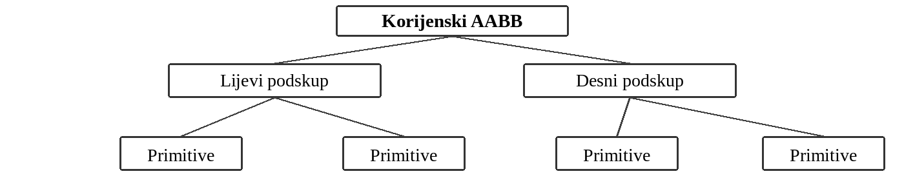

# Uvod u temu

Ray tracing je postupak generisanja slike u kojem se iz virtualne kamere kroz piksele
šalju zrake u trodimenzionalnu scenu. Program pronalazi najbližu površinu koju je pojedina
zraka pogodila i na osnovu materijala, osvjetljenja i položaja izvora svjetlosti određuje boju
piksela. Dodatne zrake omogućavaju računanje sjena i refleksija. Ovakav način renderovanja
može dati uvjerljive rezultate, ali pri većem broju objekata zahtijeva mnogo geometrijskih
proračuna [6, 7].

Najjednostavniji, takozvani naivni pristup, svaku zraku provjerava protiv svakog objekta
u sceni. Ako scena sadrži N geometrijskih primitiva, broj testova po zraci u najgorem slučaju
raste proporcionalno s N. Zbog toga se u praktičnim rendererima koriste akceleracijske
strukture koje izbjegavaju nepotrebne provjere [4].

# BVH i njegova uloga u ray tracingu

BVH (Bounding Volume Hierarchy) je hijerarhijsko stablo koje objekte organizuje u
prostorne grupe. Svaki čvor obuhvata određene primitive pomoću graničnog volumena,
najčešće AABB kutije (Axis-Aligned Bounding Box), čije su stranice paralelne
koordinatnim osama. Korijenski čvor predstavlja cijelu scenu, unutrašnji čvorovi manje
grupe, a listovi konkretne objekte. Ako zraka promaši AABB nekog čvora, mogu se
preskočiti svi objekti u njegovom podstablu. Tako se umjesto velikog broja skupih presjeka s
trouglovima izvodi manji broj jednostavnijih testova sa kutijama [7].

{width=13.9cm}

BVH nije zaseban algoritam za osvjetljenje, nego način da ray tracer brže pronađe
relevantnu geometriju. Iz literature se vidi da su važne dvije različite stvari: trošak izgradnje
stabla i brzina njegovog obilaska tokom renderovanja. Dobro stablo može zahtijevati više
vremena za pripremu, ali kasnije smanjiti broj testova presjeka. Zato u projektu planiramo
ove dvije faze mjeriti odvojeno [1, 3].

# Ostala literatura

## Gabriel Gambetta: Computer Graphics from Scratch [6]

Knjiga Gabriela Gambette pristupa računarskoj grafici od osnovnih matematičkih ideja i
ne pretpostavlja upotrebu gotovog game enginea. Posebno su korisna poglavlja o generisanju
zraka, presjecima s objektima, osvjetljenju, sjenama i refleksijama.

# Planirani koncept i tehnološki okvir

Planiramo napraviti samostalni C++ program koji će učitati ili definisati jednostavnu 3D
scenu, poslati zrake iz kamere i generisati konačnu statičnu sliku.

| Dio sistema          | Planirane tehnologije i namjena                                                     |
|----------------------|-------------------------------------------------------------------------------------|
| Osnovni program      | C++17 i CMake za prenosivu, optimizovanu izgradnju projekta.                        |
| CPU paralelizacija   | OpenMP za podjelu obrade piksela i zraka na više procesorskih niti.                 |
| Dodatna optimizacija | SIMD (SSE/AVX na odgovarajućem x86 hardveru), uz praćenje lokalnosti memorije.      |
| GPU opcija           | NVIDIA CUDA                                                                         |
| Prikaz i analiza     | PPM ili PNG slika; CSV podaci i Python grafikoni; Git za zajednički rad.            |

OpenMP omogućava direktno mjerenje skaliranja s brojem niti, a analiza SIMD-a i
memorijske lokalnosti povezuje projekat s načinom na koji procesor zaista izvršava kod.
