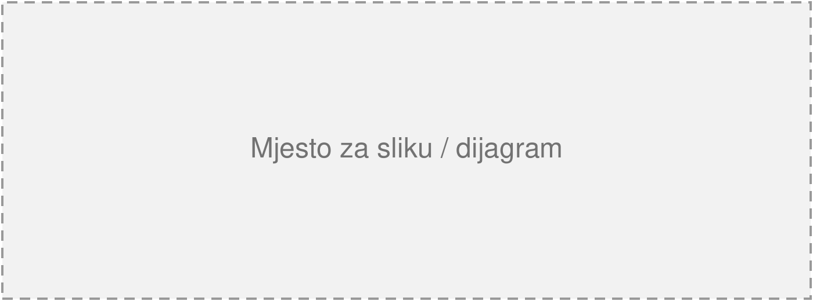

---
# ─── Naslovna strana ────────────────────────────────────────────────────────
university: Univerzitet u Sarajevu
faculty: Elektrotehnički fakultet
title: "[NAZIV PROJEKTA / TEME]"
doc_type: "[Vrsta dokumenta]"                    # npr. Istraživački izvještaj, Seminarski rad
milestone: "[Faza]"                               # npr. Checkpoint 1; obrisati liniju ako ne treba
subject: "[Naziv predmeta]"
mentor: "[Ime i prezime, titula]"
authors:
  - { name: "[Ime Prezime]", id: "[broj indeksa]" }
  - { name: "[Ime Prezime]", id: "[broj indeksa]" }
date: "Sarajevo, [mjesec] [godina]."
# logos:                     # izostaviti = UNSA + ETF logo; [] = bez logotipa
#   - { path: moj_logo.png, width: 3cm }
language: bs                 # bs | en  (mijenja "Slika/Figure", "Autori/Authors" ...)
# header: "TEKST ZAGLAVLJA"  # zadano: "UNIVERZITET  |  FAKULTET"
# footer: "Tekst podnožja"   # zadano: "naslov  |  faza" + broj strane
# toc: true                  # sadržaj na drugoj strani

# ─── Sažetak (prva sekcija, bez uvlačenja i bez broja) ─────────────────────
abstract: |
  [Kratak sažetak dokumenta u jednom pasusu (5–8 rečenica): šta je tema, koji je
  cilj, kako je urađen pregled ili implementacija i šta dokument predstavlja.]

# ─── Literatura (automatski numerisana kao posljednja sekcija) ─────────────
references:
  - "[Prezime, I., Prezime, I.] ([godina]). [Naslov rada]. [Konferencija / časopis]. doi:[...]."
  - "[Prezime, I.] ([godina]). [Naslov knjige ili izvora]. [izdavač ili URL]."
---

# Uvod u temu

[Prvi pasus uvoda. Tekst je obostrano poravnat, Times New Roman 12 pt, prored 1,15,
s uvlačenjem prvog reda od 0,5 cm. Izvori se citiraju u uglastim zagradama [1].]

[Drugi pasus. Naslovi se numerišu automatski – u Markdownu se piše samo `# Naslov`,
`## Podnaslov`. Naslov bez broja: `# Naslov {-}`.]

# [Glavna sekcija]

[Uvodni tekst sekcije. Pojam se može istaknuti **podebljano** ili *kurzivom*, a
naziv funkcije ili datoteke kao `kod`.]

{width=14cm}

[Tekst nakon slike. Na sliku se u tekstu poziva kao „Slika 1“.]

## [Podsekcija]

[Tekst podsekcije. Podnaslovi su 12 pt, podebljano, numerisani kao 2.1., 2.2. …]

- [Stavka liste]
- [Stavka liste]

## [Podsekcija sa tabelom]

[Tekst koji uvodi tabelu.]

| Kolona 1        | Kolona 2                              |
|-----------------|---------------------------------------|
| [vrijednost]    | [opis]                                |
| [vrijednost]    | [opis]                                |

: [Opis tabele – opcionalno, numeriše se kao "Tabela N."]

[Tekst nakon tabele.]

# Zaključak

[Zaključak u jednom do dva pasusa: šta je urađeno, šta je naučeno i koji su
sljedeći koraci.]
