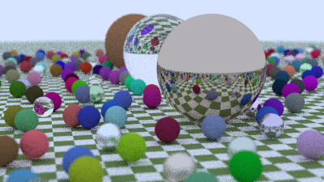
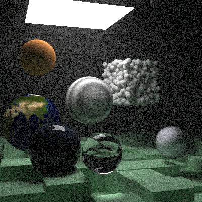

# Uvod

U prvoj fazi (Checkpoint 1) pregledali smo literaturu o BVH strukturama i planirali
izradu ray tracera u C++-u, na kojem ćemo porediti sekvencijalnu izvedbu bez BVH-a,
sekvencijalnu izvedbu s BVH-om i paralelnu izvedbu. Cilj druge faze bio je dobiti
ispravan, pregledan i mjerljiv polazni program na kojem se ta poređenja mogu izvoditi.

Umjesto pisanja renderera od nule, odlučili smo poći od koda iz knjige *Ray Tracing:
The Next Week* [1], koji je javno dostupan u repozitoriju serijala *Ray Tracing in One
Weekend* [2]. Ta knjiga uvodi upravo AABB kutije i BVH stablo, pa je njen kod prirodna
osnova za naš projekat. Originalni repozitorij je, međutim, napravljen za objavljivanje
cijelog serijala knjiga i sadrži mnogo sadržaja koji nam nije potreban. Zato smo kod
prenijeli u naš repozitorij i pročistili ga. U nastavku opisujemo strukturu projekta,
sve što smo izbacili i razloge za to, šta smo dodali te rezultate prvog mjerenja.

# Struktura projekta

Originalni repozitorij [2] sadrži izvorni kod za tri knjige (`InOneWeekend`,
`TheNextWeek` i `TheRestOfYourLife`), tekst knjiga u Markdeep formatu, stilove i
skripte za web stranicu, 107 slika i niz pratećih dokumenata. Naš repozitorij zadržava
samo jedan program i organizovan je oko foldera `Project/` za kod i foldera `docs/` za
izvještaje po fazama. Poređenje je dato u tabeli 1.

| Originalni repozitorij                                   | Naš repozitorij                                          |
|----------------------------------------------------------|----------------------------------------------------------|
| `src/InOneWeekend/`, `src/TheNextWeek/`, `src/TheRestOfYourLife/` | `Project/src/` (samo kod iz `TheNextWeek`)      |
| `src/external/` (stb biblioteke [6])                       | `Project/src/external/` (nepromijenjeno)                 |
| `images/` (107 slika: ilustracije za knjige i teksture)  | `Project/images/` (samo `earthmap.jpg`)                  |
| `books/`, `style/`, `index.html`, `favicon.png`          | izbačeno                                                 |
| `CMakeLists.txt` s 13 izvršnih ciljeva                   | `Project/CMakeLists.txt` s jednim ciljem `raytracer`     |
| `README.md`, `CHANGELOG.md`, `CONTRIBUTING.md`, `PRINTING.md`, `COPYING.txt` | `README.md` (na bosanskom), `LICENSE`, `.gitignore` |
| nema                                                     | `docs/checkpoint 1/`, `docs/checkpoint 2/` (izvještaji)  |

: Poređenje strukture originalnog i našeg repozitorija.

Folder `Project/src/` sadrži `main.cc` s devet ugrađenih scena i 17 zaglavlja
(`.h` datoteka). Za BVH su najvažnija zaglavlja `aabb.h` i `bvh.h`, a ostala pokrivaju
geometriju (`sphere.h`, `quad.h`, `constant_medium.h`), materijale (`material.h`),
teksture (`texture.h`, `perlin.h`, `rtw_stb_image.h`), kameru (`camera.h`) i
matematičke pomoćne klase (`vec3.h`, `ray.h`, `interval.h`, `rtweekend.h`).
Renderovane slike se pišu u `Project/output/`, koji je, kao i build folder, isključen
iz Gita pomoću `.gitignore`.

# Šta smo izbacili i zašto

## Druge dvije knjige serijala

Iz originalnog repozitorija preuzeli smo samo kod iz foldera `src/TheNextWeek/`.
Kod iz `InOneWeekend` je u potpunosti obuhvaćen kodom iz `TheNextWeek`, jer druga knjiga
nastavlja na prvu i proširuje iste datoteke; zadržavanje obje verzije značilo bi dvije
gotovo identične kopije istih klasa. Kod iz `TheRestOfYourLife` bavi se Monte Carlo
integracijom i uzorkovanjem po važnosti (importance sampling): uvodi klase `pdf` i
`onb` te osam samostalnih demonstracionih programa (`pi.cc`, `integrate_x_sq.cc`,
`sphere_plot.cc` i drugi). Te tehnike poboljšavaju kvalitet slike pri istom broju
uzoraka, ali ne utiču na BVH, koji je tema projekta. Njihovo uključivanje bi otežalo
tumačenje mjerenja, jer bi se promjene u vremenu mogle pripisati drugačijem načinu
uzorkovanja umjesto akceleracijskoj strukturi.

## Web dokumentacija i prateći sadržaj

Folderi `books/` i `style/`, te datoteke `index.html` i `favicon.png` služe za
generisanje web stranice s tekstom knjiga. Folder `images/` sadrži 106 ilustracija
za knjige (`fig-*.jpg`, naslovnice) i samo jednu teksturu koju program zaista koristi,
`earthmap.jpg`. Datoteke `CHANGELOG.md`, `CONTRIBUTING.md` i `PRINTING.md` opisuju
razvoj i štampanje knjiga. Ništa od toga ne učestvuje u izgradnji programa, pa smo
zadržali samo `earthmap.jpg`, koju koriste scene 3 (`earth`) i 9 (`final_scene`).
Knjige ostaju dostupne na izvornoj adresi i navedene su u literaturi [1, 2].

## Zamućenje pokreta (motion blur)

Jedina funkcionalna izmjena koda je uklanjanje zamućenja pokreta. U originalu svaka
zraka nosi vrijeme `tm`, kamera za svaki uzorak bira nasumično vrijeme unutar
intervala okidača, a pokretna sfera svoj centar čuva kao zraku i računa trenutni
položaj kao `center.at(r.time())`. Izmjene su sljedeće:

- `ray.h`: uklonjeni su član `tm`, metoda `time()` i konstruktor s tri parametra;
  zraka sada ima samo početnu tačku i smjer.
- `camera.h`: `get_ray()` više ne poziva `random_double()` za vrijeme zrake.
- `sphere.h`: uklonjen je konstruktor pokretne sfere; centar je obična tačka
  (`point3`) umjesto zrake, pa se pri svakom testu presjeka ne računa njegov položaj.
- `material.h` i `hittable.h`: rasijane zrake u četiri materijala koji rasijavaju svjetlost, kao i zrake u
  transformacijama `translate` i `rotate_y`, više ne prenose vrijeme.
- `main.cc`: pokretne sfere u scenama 1 i 9 zamijenjene su statičnim sferama u
  početnom položaju. Originalne linije su zadržane kao komentar radi poređenja.

Razloga je nekoliko. Prvo, zamućenje pokreta nije dio teme projekta. Drugo, utiče na
kvalitet samog BVH-a: AABB pokretne sfere mora obuhvatiti sferu u oba krajnja položaja,
pa je kutija veća od stvarnog objekta i zraka je češće pogađa bez stvarnog presjeka.
Time bi mjerenja BVH-a bila opterećena efektom koji ne potiče od same strukture. Treće,
manje podataka po zraci i jedan poziv generatora slučajnih brojeva manje po uzorku
pojednostavljuju kod koji ćemo u narednoj fazi paralelizovati. Posljedica je da scena 1
(`bouncing_spheres`) više ne pokazuje efekat zbog kojeg je napravljena u knjizi, ali je
zadržana kao testna scena jer sadrži oko 480 sfera, što je pogodno za mjerenje BVH-a.

## Zaglavlja s licencom i suvišni komentari

Na početku skoro svake datoteke originalni kod ima isto zaglavlje s izjavom o CC0
licenci (javno dobro). Ta zaglavlja smo uklonili i na njihovo mjesto, gdje je to imalo
smisla, upisali kratak opis uloge datoteke. Izvor koda je naveden u `README.md` i u ovom
izvještaju [1, 2]. Uklonjen je i komentar o „C++ suptilnosti“ u konstruktoru `bvh_node`,
dok je objašnjenje kopiranja liste zadržano.

# Šta smo dodali

## Jedinstven build

Originalni `CMakeLists.txt` gradi 13 izvršnih ciljeva (tri renderera i demonstracione
programe iz treće knjige). Naš gradi samo jedan, `raytracer`, iz `src/main.cc`. Na
Linuxu i macOS-u, ako tip builda nije naveden, automatski se bira Release, jer je
Debug build višestruko sporiji i mjerenja na njemu ne bi imala smisla. Standard ostaje
C++11, kao u originalu.

## Mjerenje vremena renderovanja

U `main()` je dodano mjerenje vremena pomoću `std::chrono::steady_clock`. Vrijeme se
ispisuje na standardni izlaz za greške (`std::clog`), kao i napredak po redovima, tako
da ne ulazi u PPM sliku koja se piše na standardni izlaz. Mjeri se cijelo izvršavanje
odabrane scene: izgradnja scene i BVH stabla te renderovanje.

## Komentari i dokumentacija

Svako zaglavlje sada počinje opisom onoga što definiše, a klase materijala i tekstura te
pomoćne funkcije u `vec3.h` (`reflect`, `refract`, `random_unit_vector` i druge) imaju
kratke komentare o namjeni. Komentari u kodu su na engleskom, u skladu s nazivima u
kodu. `README.md` je napisan na bosanskom i opisuje mogućnosti programa, strukturu
foldera, build na Windowsu i Linuxu/macOS-u, pokretanje, odabir scene i parametre
finalne scene.

# BVH u našem kodu

BVH je implementiran u dvije datoteke. U `aabb.h` se nalazi klasa `aabb`, kutija
zadana s tri intervala, po jedan za svaku osu. Presjek sa zrakom računa se metodom
ploča (slab method): za svaku osu se izračuna interval parametra `t` u kojem je zraka
između dvije paralelne ravni, a zraka pogađa kutiju ako se sva tri intervala preklapaju.
Vrlo tanke kutije (na primjer oko četverougla) se malo prošire kako bi se izbjegli
problemi s numeričkom preciznošću.

U `bvh.h` se nalazi klasa `bvh_node`. Izgradnja je rekurzivna: za skup objekata računa
se zajednička kutija, odabere se njena najduža osa, objekti se sortiraju po donjoj
granici svojih kutija na toj osi i dijele na dvije polovine po broju objekata. Čvor s
jednim ili dva objekta postaje list. Pri obilasku se prvo testira kutija čvora; ako je
zraka promaši, cijelo podstablo se preskače. Ako lijevo dijete ima presjek, desno se
testira samo do udaljenosti tog presjeka, čime se odbacuju dalji objekti.

Ovakva podjela je jednostavna i brzo se gradi, ali ne uzima u obzir površinu kutija,
kao što to rade heuristike zasnovane na površini (SAH) opisane u literaturi [3, 5].
Zato je ona dobra polazna tačka za poređenje s boljim načinima izgradnje. BVH se
koristi u sceni 1, gdje se cijela scena pretvara u jedno stablo, i u sceni 9, gdje se
gradi za 400 kutija poda i 1000 malih sfera.

# Prvo mjerenje

Da bismo provjerili da BVH zaista ubrzava renderovanje, uporedili smo scenu 1 s BVH-om
i bez njega. Verzija bez BVH-a dobija se zakomentarisanjem jedne linije u
`bouncing_spheres()`, pa se svi objekti testiraju jedan po jedan. Mjerenje smo
izveli na računaru s procesorom Apple M5, uz kompajler Apple clang 21 s optimizacijom
`-O3`, na jednoj niti. Rezultati su u tabeli 2.

| Scena                                   | Rezolucija | Uzorci / dubina | Bez BVH   | Sa BVH   |
|-----------------------------------------|------------|-----------------|-----------|----------|
| 1: `bouncing_spheres` (~480 sfera)      | 400 × 225  | 20 / 50         | 2,74 s    | 0,97 s   |
| 9: `final_scene`                        | 400 × 400  | 250 / 4         | –         | 23,8 s   |

: Vrijeme renderovanja (srednja vrijednost dva pokretanja za scenu 1).

Na sceni 1 BVH skraćuje vrijeme približno 2,8 puta. Bez BVH-a svaka zraka se testira protiv svih
objekata, ali dio vremena otpada na posao koji ne zavisi od broja objekata: generisanje
zraka, rasijanje na materijalima i generator slučajnih brojeva. Osim toga, stablo se
obilazi preko virtuelnih poziva i pokazivača `shared_ptr`, što ima svoj trošak. Očekujemo da razlika
raste s brojem objekata, što ćemo provjeriti u narednoj fazi. Renderovane slike su
prikazane na slikama 1 i 2.

{width=12cm}

{width=10cm}

# Naredni koraci

Na osnovu pročišćenog koda u sljedećoj fazi planiramo:

- odvojeno mjerenje vremena izgradnje BVH-a i vremena renderovanja, kako je
  predloženo u Checkpointu 1 [4];
- scene s većim i podesivim brojem objekata, radi mjerenja kako ubrzanje raste s
  veličinom scene;
- paralelizaciju renderovanja po redovima slike pomoću OpenMP-a; pri tome generator
  slučajnih brojeva, koji sada koristi `std::rand()`, treba zamijeniti generatorom po
  niti, jer `std::rand()` nije bezbjedan za istovremeno korištenje iz više niti;
- poređenje trenutne podjele po medijani s podjelom zasnovanom na SAH-u [3, 5].
