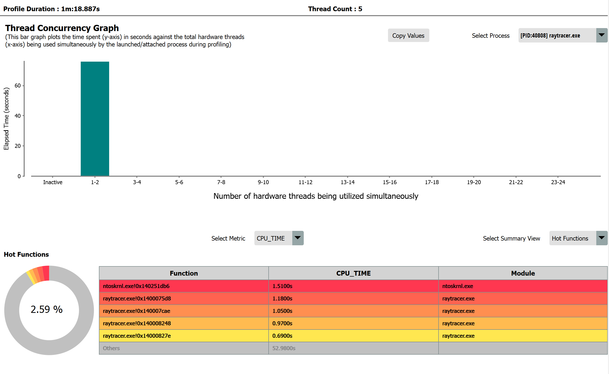

# Uvod

U Checkpointu 2 smo pripremili sekvencijalnu implementaciju ray tracera s BVH
strukturom, zasnovanu na knjizi *Ray Tracing: The Next Week* [1]. U ovoj fazi smo
uradili dvije stvari. Prvo, dodali smo biblioteku GLFW [2] i napravili animaciju
finalne scene. Drugo, sekvencijalnu verziju smo pustili kroz profiler na dva
različita računara, da vidimo koje metode najviše troše vremena. Te rezultate ćemo
koristiti u narednoj fazi, kada budemo paralelizovali renderovanje.

# Biblioteka GLFW i animacija

GLFW je biblioteka za otvaranje prozora i rad s OpenGL-om. Koristimo je da bismo
renderovane slike prikazali u prozoru, umjesto da ih samo snimamo u PPM datoteku.
Uz nju smo napravili novi program `animation`. On scenu i BVH izgradi jednom, a zatim
za svaki frejm malo pomjeri kameru po zatvorenoj putanji oko finalne scene i
renderuje novu sliku. Kamera obilazi scenu, primiče joj se i odmiče, te se penje i
spušta. Tokom renderovanja se u prozoru vidi kako se frejm iscrtava, a na kraju se
svi frejmovi puštaju u petlji, pa izgleda kao da se kamera kreće.

GLFW smo dodali na sljedećim mjestima:

- `Project/CMakeLists.txt`: novi cilj `animation`. CMake prvo traži GLFW instaliran
  na sistemu, a ako ga ne nađe, sam preuzme i izgradi GLFW 3.4 (`FetchContent`).
  Program se povezuje s bibliotekama `glfw` i `OpenGL`. Animacija se može
  isključiti opcijom `-DBUILD_ANIMATION=OFF`.
- `Project/src/animation.cc`: novi program, odnosno prozor, putanja kamere,
  renderovanje frejmova i reprodukcija. Gotovi frejmovi se snimaju kao PNG datoteke
  u `output/frames/` pomoću biblioteke `stb_image_write` [3], a od njih se može
  napraviti i video.
- `Project/src/scenes.h`: izgradnju finalne scene smo izdvojili u zasebnu funkciju,
  da je koriste i `raytracer` i `animation`.
- `camera.h`, `color.h` i `rtweekend.h`: male dopune, i to računanje boje jednog
  piksela, pretvaranje boje u bajtove za PNG i zaseban generator slučajnih brojeva
  koji se koristi samo u animaciji.

I animacija se, kao i `raytracer`, renderuje sekvencijalno na jednoj niti. Program
`raytracer` radi kao u Checkpointu 2, pa su sva mjerenja u nastavku urađena na njemu.

# Profilisanje sekvencijalne izvedbe

Profilisali smo finalnu scenu (scena 9) u brzoj testnoj verziji: 400 × 400 piksela,
250 uzoraka po pikselu i dubina 4, s uključenim BVH-om. Program radi na jednoj niti.

## Apple M5

Na Apple M5 smo koristili alat Instruments iz Xcodea, šablon Time Profiler [4].
Program smo za ovo izgradili kao Release (`-O3`), uz debug simbole (`-g`), da bi se
u profilu vidjela imena metoda. Ukupno trajanje je bilo 21,84 s. Raspodjela vremena
po fazama je u tabeli 1.

| Faza | Vrijeme | Udio |
|------|--------:|-----:|
| izgradnja scene i BVH stabla | 16 ms | 0,1 % |
| renderovanje (`camera::render`) | 21,80 s | 99,8 % |
| generisanje primarnih zraka (`get_ray`) | 104 ms | 0,5 % |
| upis piksela u PPM (`write_color`) | 35 ms | 0,2 % |

: Raspodjela vremena po fazama na Apple M5 (ukupno 21,84 s).

Izgradnja BVH stabla je zanemariva, a skoro sve vrijeme odlazi na praćenje zraka.
Metode koje same troše najviše vremena date su u tabeli 2, a izgled profila na
slici 1.

| Metoda | Vrijeme | Udio | Opis |
|--------|--------:|-----:|------|
| `aabb::hit` | 5,54 s | 25,4 % | presjek zrake s kutijom BVH čvora |
| `sphere::get_sphere_uv` | 3,31 s | 15,2 % | UV koordinate na sferi |
| `constant_medium::hit` | 1,79 s | 8,2 % | presjek s maglom i dimom |
| `quad::hit` | 1,76 s | 8,1 % | presjek s četverouglom |
| `bvh_node::hit` | 1,15 s | 5,3 % | obilazak BVH stabla |
| `random_double` | 0,94 s | 4,3 % | slučajni brojevi (`std::rand`) |
| `vec3::operator[]` | 0,89 s | 4,1 % | pristup komponentama vektora |
| `sphere::hit` | 0,86 s | 4,0 % | presjek sa sferom |
| `hittable_list::hit` | 0,86 s | 3,9 % | prolazak kroz listu objekata |
| `dot` | 0,58 s | 2,7 % | skalarni proizvod |

: Deset metoda s najvećim vlastitim vremenom (Self Weight) na Apple M5.

{width=15.9cm}

Obilazak BVH-a (`aabb::hit`, `bvh_node::hit` i većina `vec3::operator[]`) zajedno
uzima oko 35 % vremena. To smo i očekivali, jer BVH zamjenjuje skupe testove s
objektima velikim brojem jeftinih testova s kutijama. Iznenadilo nas je da
`get_sphere_uv` uzima 15 %. UV koordinate se računaju pri svakom pogotku sfere, iako
su potrebne samo sferama s teksturom. Vidi se i oko 4–5 % vremena na kopiranju
pokazivača `shared_ptr` na materijal pri svakom pogotku.

## AMD Ryzen AI 9 HX 370

Na računaru s procesorom AMD Ryzen AI 9 HX 370 (s grafikom Radeon 890M) pokrenuli
smo istu scenu s istim parametrima i profilisali je alatom AMD uProf [5]. Rezultat
je prikazan na slici 2.

{width=15.9cm}

Profilisanje je trajalo 1 min 18,9 s. Graf istovremeno korištenih hardverskih niti
(Thread Concurrency Graph) pokazuje da je program cijelo vrijeme koristio samo 1–2
niti od 24 dostupne, čime se potvrđuje da je izvedba sekvencijalna. Najviše
procesorskog vremena pojedinačno uzima jezgro operativnog sistema
(`ntoskrnl.exe`, 1,51 s), a zatim četiri funkcije iz `raytracer.exe` (od 0,69 s do
1,18 s). Funkcije programa su prikazane kao adrese, a ne kao imena, jer alat nije
učitao debug simbole. Zato ih ne možemo direktno uporediti s rezultatima s Apple M5.
Ostale funkcije zajedno uzimaju 52,98 s.

Ista scena je na AMD računaru trajala oko 79 s, a na Apple M5 21,84 s. Razlika je
velika, ali dio nje otpada na sam profiler i na drugačiji kompajler i build na
Windowsu, pa ovo ne smatramo tačnim poređenjem brzine procesora. Tačnije poređenje
ćemo uraditi u narednoj fazi, mjerenjem bez profilera.

# Naredni koraci

- Paralelizacija renderovanja po redovima slike. Pikseli su međusobno nezavisni, pa
  se redovi mogu dijeliti nitima.
- Generator slučajnih brojeva po niti umjesto `std::rand()`, koji nije bezbjedan za
  više niti.
- Provjera da kopiranje `shared_ptr` pri svakom pogotku ne usporava niti, jer se
  pri tome atomski mijenja zajednički brojač referenci.
- Ponovno profilisanje na AMD računaru s debug simbolima, da bi se vidjela imena
  metoda.
- Mjerenje ubrzanja paralelne verzije za različit broj niti na oba računara.
