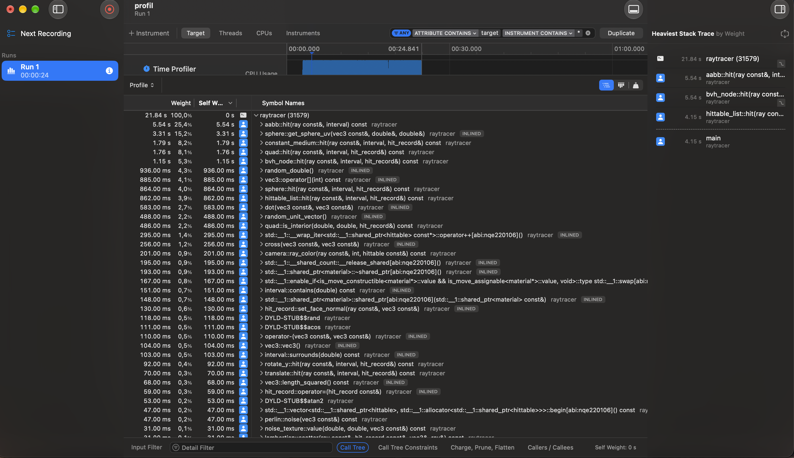
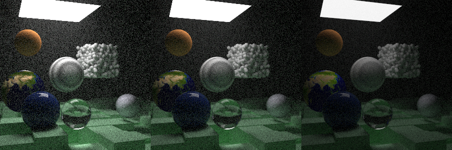
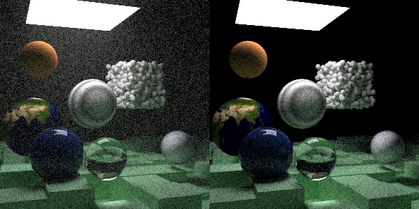
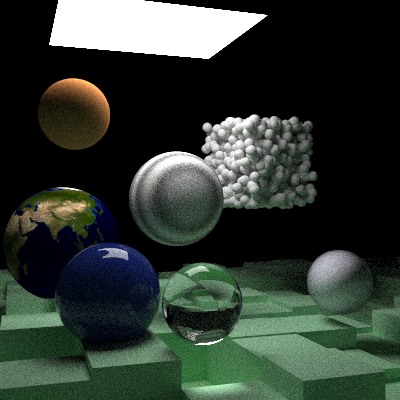

# Uvod

U Checkpointu 2 smo pripremili sekvencijalnu implementaciju ray tracera s BVH
strukturom, zasnovanu na knjizi *Ray Tracing: The Next Week* [1]. U ovoj fazi smo
uradili tri stvari. Prvo, dodali smo biblioteku GLFW [2] i napravili animaciju
finalne scene. Drugo, sekvencijalnu verziju smo pustili kroz profiler na dva
različita računara, da vidimo koje metode najviše troše vremena. Treće, napravili
smo interaktivni pregled scene s vremenskom akumulacijom i probali da li se njome
može brže dobiti čista slika. Rezultate profilisanja ćemo koristiti u narednoj fazi,
kada budemo paralelizovali renderovanje.

# Biblioteka GLFW i animacija

GLFW je biblioteka za otvaranje prozora i rad s OpenGL-om. Koristimo je da bismo
renderovane slike prikazali u prozoru, umjesto da ih samo snimamo u PPM datoteku.
Uz nju smo napravili novi program `animation`. On scenu i BVH izgradi jednom, a zatim
za svaki frejm malo pomjeri kameru po zatvorenoj putanji oko finalne scene i
renderuje novu sliku. Kamera obilazi scenu, primiče joj se i odmiče, te se penje i
spušta. Tokom renderovanja se u prozoru vidi kako se frejm iscrtava, a na kraju se
svi frejmovi puštaju u petlji, pa izgleda kao da se kamera kreće.

GLFW smo dodali na sljedećim mjestima:

- `Project/CMakeLists.txt`: novi cilj `animation`. CMake prvo traži GLFW instaliran
  na sistemu, a ako ga ne nađe, sam preuzme i izgradi GLFW 3.4 (`FetchContent`).
  Program se povezuje s bibliotekama `glfw` i `OpenGL`. Animacija se može
  isključiti opcijom `-DBUILD_ANIMATION=OFF`.
- `Project/src/animation.cc`: novi program, odnosno prozor, putanja kamere,
  renderovanje frejmova i reprodukcija. Gotovi frejmovi se snimaju kao PNG datoteke
  u `output/frames/` pomoću biblioteke `stb_image_write` [3], a od njih se može
  napraviti i video.
- `Project/src/scenes.h`: izgradnju finalne scene smo izdvojili u zasebnu funkciju,
  da je koriste i `raytracer` i `animation`.
- `camera.h`, `color.h` i `rtweekend.h`: male dopune, i to računanje boje jednog
  piksela, pretvaranje boje u bajtove za PNG i zaseban generator slučajnih brojeva
  koji se koristi samo u animaciji.

I animacija se, kao i `raytracer`, renderuje sekvencijalno na jednoj niti. Program
`raytracer` radi kao u Checkpointu 2, pa su sva mjerenja u nastavku urađena na njemu.

# Profilisanje sekvencijalne izvedbe

Profilisali smo finalnu scenu (scena 9) u brzoj testnoj verziji: 400 × 400 piksela,
250 uzoraka po pikselu i dubina 4, s uključenim BVH-om. Program radi na jednoj niti.
Sva mjerenja u ovoj i sljedećoj sekciji urađena su na originalnoj sceni, prije
uklanjanja sfere magle opisanog u sekciji 5.

## Apple M5

Na Apple M5 smo koristili alat Instruments iz Xcodea, šablon Time Profiler [4].
Program smo za ovo izgradili kao Release (`-O3`), uz debug simbole (`-g`), da bi se
u profilu vidjela imena metoda. Ukupno trajanje je bilo 21,84 s. Raspodjela vremena
po fazama je u tabeli 1.

| Faza | Vrijeme | Udio |
|------|--------:|-----:|
| izgradnja scene i BVH stabla | 16 ms | 0,1 % |
| renderovanje (`camera::render`) | 21,80 s | 99,8 % |
| generisanje primarnih zraka (`get_ray`) | 104 ms | 0,5 % |
| upis piksela u PPM (`write_color`) | 35 ms | 0,2 % |

: Raspodjela vremena po fazama na Apple M5 (ukupno 21,84 s).

Izgradnja BVH stabla je zanemariva, a skoro sve vrijeme odlazi na praćenje zraka.
Metode koje same troše najviše vremena date su u tabeli 2, a izgled profila na
slici 1.

| Metoda | Vrijeme | Udio | Opis |
|--------|--------:|-----:|------|
| `aabb::hit` | 5,54 s | 25,4 % | presjek zrake s kutijom BVH čvora |
| `sphere::get_sphere_uv` | 3,31 s | 15,2 % | UV koordinate na sferi |
| `constant_medium::hit` | 1,79 s | 8,2 % | presjek s maglom i dimom |
| `quad::hit` | 1,76 s | 8,1 % | presjek s četverouglom |
| `bvh_node::hit` | 1,15 s | 5,3 % | obilazak BVH stabla |
| `random_double` | 0,94 s | 4,3 % | slučajni brojevi (`std::rand`) |
| `vec3::operator[]` | 0,89 s | 4,1 % | pristup komponentama vektora |
| `sphere::hit` | 0,86 s | 4,0 % | presjek sa sferom |
| `hittable_list::hit` | 0,86 s | 3,9 % | prolazak kroz listu objekata |
| `dot` | 0,58 s | 2,7 % | skalarni proizvod |

: Deset metoda s najvećim vlastitim vremenom (Self Weight) na Apple M5.

{width=15.9cm}

Kada metode grupišemo po namjeni (tabela 3), vidi se da najviše vremena uzima
traženje presjeka zrake sa scenom. Skoro sve metode na vrhu liste su `hit` metode,
a najčešći put kroz program u profilu je `main` → `hittable_list::hit` →
`bvh_node::hit` → `aabb::hit`.

| Grupa | Metode | Udio |
|-------|--------|-----:|
| obilazak BVH stabla | `aabb::hit`, `bvh_node::hit`, `vec3::operator[]` | ~35 % |
| presjeci s objektima | `constant_medium::hit`, `quad::hit`, `sphere::hit`, `hittable_list::hit`, `quad::is_interior` | ~26 % |
| UV koordinate sfere | `sphere::get_sphere_uv` | ~15 % |
| slučajni brojevi | `random_double`, `random_unit_vector`, `rand` | ~7 % |
| `shared_ptr` na materijal | kopiranje i brisanje `shared_ptr<material>` | ~4–5 % |

: Udio vremena po grupama metoda na Apple M5.

Obilazak BVH-a uzima oko 35 % vremena. To smo i očekivali, jer BVH zamjenjuje skupe
testove s objektima velikim brojem jeftinih testova s kutijama, pa je `aabb::hit`
najskuplja pojedinačna metoda. Iznenadilo nas je da `get_sphere_uv` uzima 15 %. UV
koordinate se računaju pri svakom pogotku sfere, iako su potrebne samo sferama s
teksturom.

S druge strane, materijali i kamera su skoro zanemarivi. `camera::ray_color` sam troši
samo 0,9 %, a metode `scatter` materijala nisu ni među prvih 30. Dakle, gotovo sav
posao je u geometriji, odnosno u `hit` metodama, a ne u računanju boje.

## AMD Ryzen AI 9 HX 370

Na računaru s procesorom AMD Ryzen AI 9 HX 370 (s grafikom Radeon 890M) pokrenuli
smo istu scenu s istim parametrima i profilisali je alatom AMD uProf [5]. Rezultat
je prikazan na slici 2.

{width=15.9cm}

Profilisanje je trajalo 1 min 18,9 s. Graf istovremeno korištenih hardverskih niti
(Thread Concurrency Graph) pokazuje da je program cijelo vrijeme koristio samo 1–2
niti od 24 dostupne, čime se potvrđuje da je izvedba sekvencijalna. Najviše
procesorskog vremena pojedinačno uzima jezgro operativnog sistema
(`ntoskrnl.exe`, 1,51 s), a zatim četiri funkcije iz `raytracer.exe` (od 0,69 s do
1,18 s). Funkcije programa su prikazane kao adrese, a ne kao imena, jer alat nije
učitao debug simbole. Zato ih ne možemo direktno uporediti s rezultatima s Apple M5.
Ostale funkcije zajedno uzimaju 52,98 s.

Ista scena je na AMD računaru trajala oko 79 s, a na Apple M5 21,84 s. Razlika je
velika, ali dio nje otpada na sam profiler i na drugačiji kompajler i build na
Windowsu, pa ovo ne smatramo tačnim poređenjem brzine procesora. Tačnije poređenje
ćemo uraditi u narednoj fazi, mjerenjem bez profilera.

# Vremenska akumulacija

Napravili smo i program `interactive`, u kojem se kamera oko finalne scene pomjera
mišem i tastaturom. Koristi vremensku (progresivnu) akumulaciju (temporal
accumulation): svaki prolaz renderuje samo jedan uzorak po pikselu i dodaje ga u
bafer, a prozor prikazuje prosjek svih dosadašnjih prolaza. Kad se kamera pomjeri,
bafer se briše i akumulacija kreće ispočetka. I ovaj program radi sekvencijalno, na
jednoj niti, i koristi isti generator slučajnih brojeva kao `raytracer`. Tabela 4
poredi vremena za istu sliku kao u tabeli 1.

| Program | 1 uzorak | 50 uzoraka | 250 uzoraka |
|---------|---------:|-----------:|------------:|
| `interactive` (akumulacija) | 0,12 s | 4,9 s | 24,8 s |
| `raytracer` | — | — | ~21,5 s |

: Vrijeme do datog broja uzoraka po pikselu (Apple M5, 400 × 400, dubina 4).

Prednost je što se slika vidi odmah, a ne tek nakon 21 s. Akumulacija je ukupno
oko 15 % sporija, jer se nakon svakog prolaza ponovo računa prikazana slika. Međutim,
čistoću slike nije poboljšala. Slika sa N prolaza po jedan uzorak je ista kao slika
sa N uzoraka odjednom, pa šum zavisi samo od broja uzoraka. I nakon 910 uzoraka
(oko 2,5 min) slika je bila vidno zrnasta, posebno u tamnoj pozadini i u sjenama.
Ova scena ima samo jedno malo svjetlo, pa ga pogodi malo zraka.

Zato smo dodali i opciju `--clamp`, koja ograničava svjetlinu svakog pojedinačnog
uzorka. Ideja je bila da zrnca prave rijetki, vrlo svijetli uzorci, npr. zraka koja
se rasprši u magli i zatim pogodi svjetlo. Rezultati su u tabeli 5 i na slici 3.

| Clamp | Šum u pozadini | Šum na podu | Prosječna svjetlina |
|-------|---------------:|------------:|--------------------:|
| bez clampa | 24,0 | 14,8 | 68,3 |
| 3 | 16,3 | 10,9 | 54,7 |
| 1 | 9,7 | 6,3 | 37,8 |

: Uticaj clampa na šum i svjetlinu slike (300 × 300, 300 uzoraka po pikselu). Šum je prosječna razlika susjednih piksela.

{width=15.9cm}

Clamp 3 smanjuje šum za oko 30 %, ali je slika oko 20 % tamnija, jer se odsječeni
dio svjetlosti gubi. Pokazalo se da većina šuma ne dolazi od pojedinačnih svijetlih
uzoraka, nego od toga što premalo uzoraka uopšte pogodi svjetlo. Zato clamp ostaje
samo pomoćna opcija, a po defaultu je isključen.

# Uklanjanje sfere magle

Tražeći uzrok šuma, primijetili smo da finalna scena iz knjige [1] cijelu scenu
obavija velikom sferom magle (poluprečnik 5000, gustina 0,0001). Kroz nju prolazi
svaka zraka. Pozadina scene je crna, pa pozadina dobija svjetlo samo kad se zraka
rasprši u magli i nakon toga slučajno pogodi malo svjetlo. To se dešava rijetko,
pa je pozadina siva i zrnasta. Uporedili smo istu sliku sa i bez te sfere (tabela 6
i slika 4).

| Scena | Šum u pozadini | Šum na podu | Vrijeme (300 × 300, 300 uzoraka) |
|-------|---------------:|------------:|---------------------------------:|
| s maglom | 23,95 | 14,81 | 24,7 s |
| bez magle | 0,93 | 14,19 | 16,5 s |

: Uticaj velike sfere magle na šum i vrijeme renderovanja.

{width=13cm}

Bez magle je pozadina potpuno crna i bez šuma, dok je šum na podu i sferama skoro
isti, jer on dolazi od malog svjetla. Magla je usporavala i renderovanje, jer se za
svaku zraku poziva `constant_medium::hit`, što se vidjelo i u profilu (8,2 %).
Zato smo je izbacili iz koda (`scenes.h`). Mala plava staklena sfera s maglom unutra
je ostala. Nakon izmjene `raytracer` za brzu verziju finalne scene treba 13,7 s
umjesto 21,4 s, a `interactive` dostiže 250 uzoraka za 16,2 s umjesto 24,8 s. Ovo
je odstupanje od scene iz knjige, pa su mjerenja iz Checkpointa 2 i sekcija 3 i 4
rađena na sceni s maglom i nisu direktno uporediva s novim.

# Podrazumijevani kvalitet slike

Na kraju smo u sva tri programa podigli podrazumijevani broj uzoraka po pikselu na
1000 i maksimalnu dubinu zrake na 20 (tabela 7), da bi slika bez dodatnih opcija
bila čistija.

| Program | Prije | Sada |
|---------|-------|------|
| `raytracer` | 250 uzoraka, dubina 4 | 1000 uzoraka, dubina 20 |
| `animation` | 50 uzoraka, dubina 8 | 1000 uzoraka, dubina 20 |
| `interactive` | do 1000 uzoraka, dubina 10 | do 1000 uzoraka, dubina 20 |

: Podrazumijevani broj uzoraka po pikselu i dubina zrake.

Na sceni bez magle `raytracer` s novim postavkama treba 110 s na Apple M5, umjesto
13,7 s. Rezultat je na slici 5. Šum je vidno manji nego na slikama iz sekcija 4 i 5,
ali se renderovanje produžilo oko osam puta. Animacija od 72 frejma s ovim postavkama
trajala bi oko 2,2 sata, pa ćemo je renderovati tek nakon paralelizacije. Mjerenja u
ovom izvještaju i dalje su rađena s brzom verzijom (250 uzoraka, dubina 4), jer je
ona dovoljna za poređenje vremena.

{width=9cm}

# Naredni koraci

- Paralelizacija renderovanja po redovima slike. Pikseli su međusobno nezavisni, pa
  se redovi mogu dijeliti nitima.
- Generator slučajnih brojeva po niti umjesto `std::rand()`, koji nije bezbjedan za
  više niti.
- Provjera da kopiranje `shared_ptr` pri svakom pogotku ne usporava niti, jer se
  pri tome atomski mijenja zajednički brojač referenci.
- Ponovno profilisanje na oba računara na sceni bez magle, na AMD računaru s debug
  simbolima, da bi se vidjela imena metoda.
- Mjerenje ubrzanja paralelne verzije za različit broj niti na oba računara.
- Uzorkovanje svjetla (light sampling), da bi se dobila čistija slika s istim brojem
  uzoraka.
